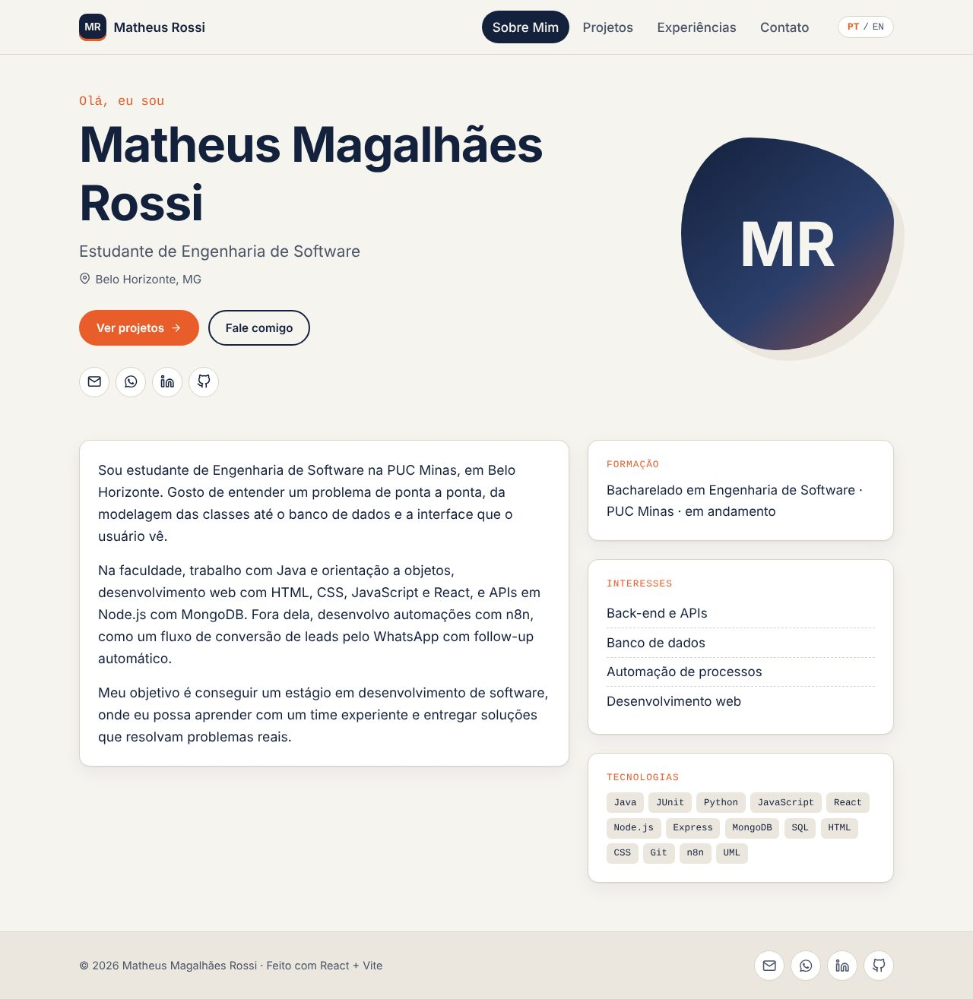
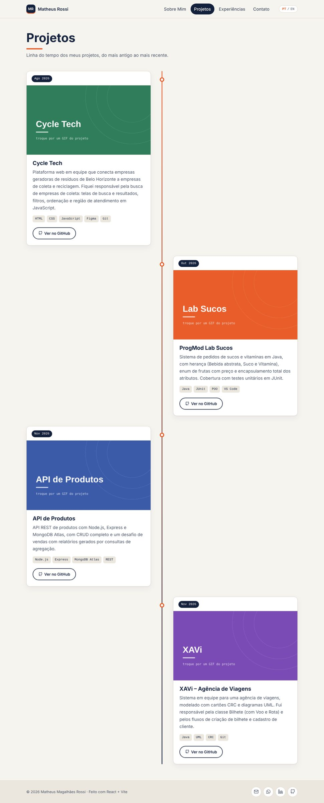
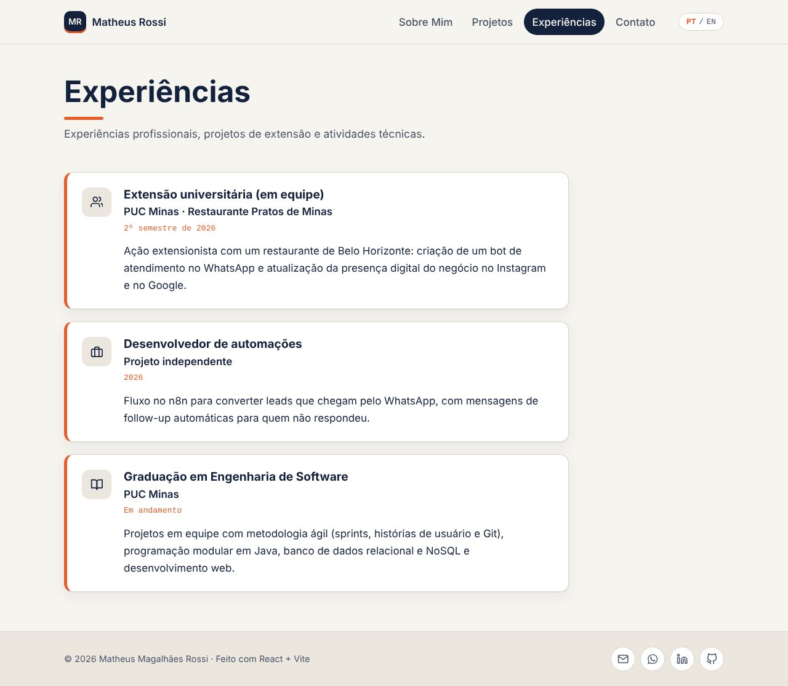
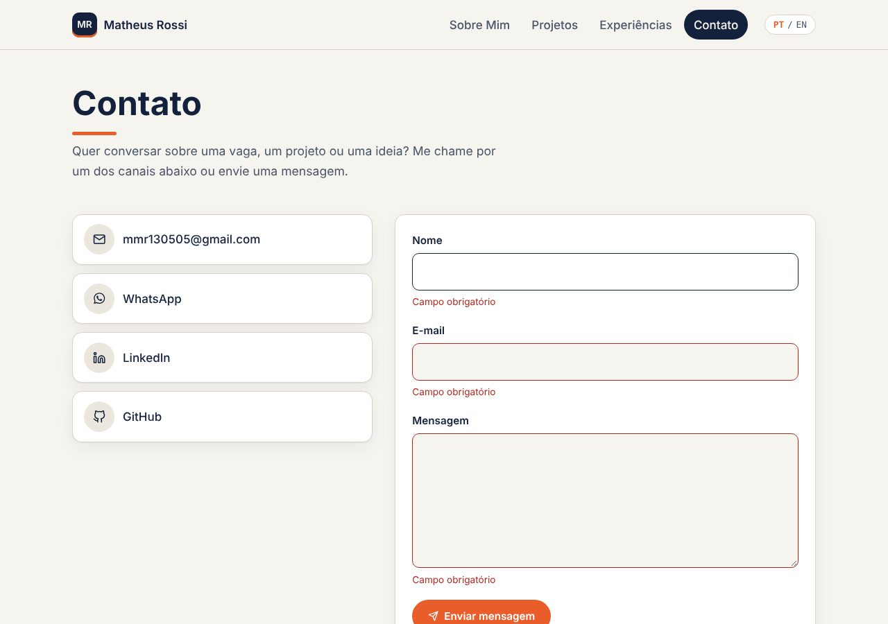
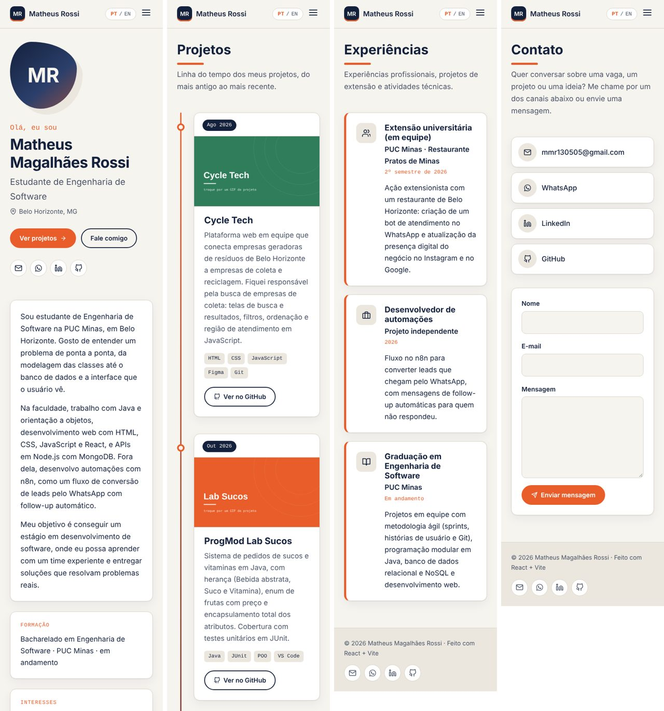

---

# 🏷️ Portfólio Profissional — Matheus Rossi 👨‍💻

> [!NOTE]
> Site de portfólio pessoal, bilíngue (português e inglês), que reúne em um só lugar minha apresentação, a linha do tempo dos meus projetos, minhas experiências e um formulário de contato que envia e-mail de verdade.

<table>
  <tr>
    <td width="800px">
      <div align="justify">
        Este repositório contém o <b>Trabalho Prático 1</b> da disciplina de <i>Desenvolvimento e Integração de Aplicações Web</i> do curso de <b>Engenharia de Software da PUC Minas</b>. O site foi desenvolvido em <b>React + Vite</b> e está hospedado gratuitamente na <b>Vercel</b>. Ele apresenta minha trajetória, habilidades, projetos e formas de contato de maneira moderna, responsiva e acessível, servindo como cartão de visitas para recrutadores e processos seletivos de estágio.
      </div>
    </td>
    <td>
      <div>
        
      </div>
    </td>
  </tr>
</table>

---

## 🚧 Status do Projeto


---

## 📚 Índice
- [Links Úteis](#-links-úteis)
- [Sobre o Projeto](#-sobre-o-projeto)
- [Funcionalidades Principais](#-funcionalidades-principais)
- [Tecnologias Utilizadas](#-tecnologias-utilizadas)
- [Dependências](#-dependências)
- [Arquitetura](#-arquitetura)
- [Instalação e Execução](#-instalação-e-execução)
  - [Pré-requisitos](#pré-requisitos)
  - [Variáveis de Ambiente](#-variáveis-de-ambiente)
  - [Instalação de Dependências](#-instalação-de-dependências)
  - [Como Executar a Aplicação](#-como-executar-a-aplicação)
- [Deploy](#-deploy)
- [Estrutura de Pastas](#-estrutura-de-pastas)
- [Como atualizar o conteúdo](#-como-atualizar-o-conteúdo)
- [Demonstração](#-demonstração)
- [Testes](#-testes)
- [Documentações utilizadas](#-documentações-utilizadas)
- [Autores](#-autores)
- [Contribuição](#-contribuição)
- [Agradecimentos](#-agradecimentos)
- [Licença](#-licença)

---

## 🔗 Links Úteis
* 🌐 **Demo Online:** [Acesse o portfólio](https://SEU-PROJETO.vercel.app)
  > 💻 **Descrição:** Site em produção, hospedado gratuitamente na Vercel com deploy automático a cada `push` na branch `main`.
* 🎨 **Protótipo:** [Wireframes no Figma](https://www.figma.com/SEU-LINK)
  > 📐 **Descrição:** Wireframes de média fidelidade das quatro páginas, nas versões desktop e mobile.

---

## 📝 Sobre o Projeto

- **Por que ele existe:** para ter um lugar único e profissional onde recrutadores e colegas possam conhecer quem eu sou, o que já construí e como falar comigo.
- **Qual problema ele resolve:** currículo em PDF não mostra projetos rodando nem o código. O portfólio reúne descrição, tecnologias, GIF/print e link do repositório de cada projeto.
- **Contexto:** acadêmico (Trabalho Prático 1, PUC Minas) e profissional, já que será usado em candidaturas de estágio.
- **Onde pode ser utilizado:** em candidaturas, no perfil do LinkedIn, no GitHub e em apresentações.

---

## ✨ Funcionalidades Principais

- 🧭 **Navegação entre páginas:** menu com as seções Sobre Mim, Projetos, Experiências e Contato, com rotas próprias (React Router) e menu hambúrguer no celular.
- 🌐 **Internacionalização (PT/EN):** botão no cabeçalho alterna todo o site entre português e inglês. A escolha fica salva no navegador.
- 🕒 **Timeline dinâmica de projetos:** gerada a partir de um arquivo de dados e ordenada automaticamente do projeto mais antigo ao mais recente. Cada projeto tem nome, descrição, tecnologias, link do GitHub e imagem/GIF.
- 💼 **Experiências organizadas:** cartões com instituição, cargo/atividade, período e descrição.
- 📨 **Formulário de contato funcional:** envio de e-mail pelo EmailJS, com validação de nome, e-mail e mensagem (React Hook Form) e avisos de sucesso/erro.
- 🔗 **Ícones clicáveis:** e-mail, WhatsApp, LinkedIn e GitHub.
- 📱 **Design responsivo:** layout adaptado para desktop, tablet e celular.
- 🎞️ **Animações suaves:** entrada de elementos com Framer Motion, respeitando a preferência de "movimento reduzido" do sistema.
- 🚫 **Página 404** para rotas inexistentes.

---

## 🛠 Tecnologias Utilizadas

### 💻 Front-end

* **Framework/Biblioteca:** React 19
* **Linguagem:** JavaScript (ES6+) e JSX
* **Estilização:** CSS puro com variáveis (design system próprio em `src/styles/global.css`)
* **Gerenciamento de Estado:** Context API (idioma) e `useState`
* **Roteamento:** React Router 7
* **Formulários:** React Hook Form
* **Animações:** Framer Motion
* **Ícones:** React Icons (Feather e Font Awesome)
* **Envio de e-mail:** EmailJS
* **Build Tool:** Vite 8
* **Lint:** Oxlint

### 🖥️ Back-end

* Não se aplica. O site é estático e o envio de e-mail é feito direto do front-end pelo serviço EmailJS.

### ⚙️ Infraestrutura & DevOps

* **Cloud:** Vercel (plano gratuito)
* **CI/CD:** deploy automático da Vercel integrado ao GitHub
* **Versionamento:** Git e GitHub

---

## 📦 Dependências

| Pacote | Versão | Uso |
| :--- | :---: | :--- |
| `react` / `react-dom` | ^19.3 | Biblioteca de interface |
| `react-router-dom` | ^7.18 | Rotas e navegação entre páginas |
| `@emailjs/browser` | ^5.0 | Envio do formulário de contato por e-mail |
| `react-hook-form` | ^7.92 | Controle e validação do formulário |
| `framer-motion` | ^14.14 | Animações de entrada |
| `react-icons` | ^5.7 | Ícones das redes sociais e da interface |
| `vite` *(dev)* | ^8.3 | Servidor de desenvolvimento e build |
| `@vitejs/plugin-react` *(dev)* | ^6 | Suporte a React/JSX no Vite |
| `oxlint` *(dev)* | ^1.9 | Análise estática do código |

---

## 🏗 Arquitetura

O projeto é uma **SPA (Single Page Application)** organizada em camadas simples:

- **Dados (`src/data/`)**: todo o conteúdo do site (textos em PT/EN, projetos, experiências e dados de contato) fica em arquivos JavaScript separados dos componentes. Para incluir um projeto novo, basta adicionar um objeto no array, sem mexer em JSX.
- **Contexto (`src/context/`)**: o `LanguageContext` guarda o idioma atual e entrega os textos certos para qualquer componente via hook `useIdioma()`.
- **Componentes (`src/components/`)**: peças reutilizáveis (cabeçalho, rodapé, ícones de redes sociais, título de página e item da timeline).
- **Páginas (`src/pages/`)**: uma página por rota, que combina componentes e dados.
- **Estilos (`src/styles/`)**: um único CSS global com variáveis de cor, fonte e espaçamento (identidade visual).

**Fluxo de dados:** `data/*.js` → página → componentes. O idioma vem do contexto e escolhe a versão `pt` ou `en` de cada texto.

**Decisões e trade-offs:**
- **CSS puro em vez de biblioteca de componentes:** dá mais controle sobre a identidade visual e deixa o bundle menor.
- **i18n sem biblioteca:** com só dois idiomas e pouco texto, um objeto `{ pt, en }` + Context resolve sem dependência extra.
- **EmailJS em vez de back-end próprio:** o formulário funciona sem servidor, mantendo a hospedagem 100% gratuita. A limitação é a cota mensal do plano gratuito do EmailJS.
- **`vercel.json` com rewrite:** como a navegação usa `BrowserRouter`, todas as rotas são redirecionadas para o `index.html`, evitando erro 404 ao recarregar `/projetos`, por exemplo.

---

## 🔧 Instalação e Execução

### Pré-requisitos

* **Node.js:** versão LTS (v20 ou superior)
* **Gerenciador de pacotes:** npm
* **Git**
* Conta gratuita no **EmailJS** (apenas para testar o envio do formulário)

---

### 🔑 Variáveis de Ambiente

Crie um arquivo **`.env`** na raiz do projeto (há um modelo em `.env.example`):

| Variável | Descrição | Exemplo |
| :--- | :--- | :--- |
| `VITE_EMAILJS_SERVICE_ID` | ID do serviço de e-mail criado no EmailJS | `service_abc123` |
| `VITE_EMAILJS_TEMPLATE_ID` | ID do template de e-mail | `template_xyz789` |
| `VITE_EMAILJS_PUBLIC_KEY` | Chave pública da conta EmailJS | `AbCdEfGh123` |

```
VITE_EMAILJS_SERVICE_ID=seu_service_id_aqui
VITE_EMAILJS_TEMPLATE_ID=seu_template_id_aqui
VITE_EMAILJS_PUBLIC_KEY=sua_public_key_aqui
```

O template do EmailJS deve usar as variáveis `{{name}}`, `{{email}}` e `{{message}}`.

> **Obs:** em projetos **Vite** as variáveis precisam começar com `VITE_` para ficarem disponíveis no código do front-end. O `.env` está no `.gitignore` e não vai para o GitHub. Na Vercel, cadastre as mesmas variáveis em **Project Settings → Environment Variables**.

---

### 📦 Instalação de Dependências

```bash
git clone https://github.com/Matheus-Rossi13/portfolio.git
cd portfolio
npm install
```

---

### ⚡ Como Executar a Aplicação

```bash
npm run dev
```
🎨 *O site estará disponível em **http://localhost:5173**.*

Outros scripts:

```bash
npm run build     # gera a versão de produção na pasta /dist
npm run preview   # serve a pasta /dist localmente para conferir o build
npm run lint      # verifica o código com o Oxlint
```

---

## 🚀 Deploy

1. Faça login em [vercel.com](https://vercel.com) com a conta do GitHub.
2. Clique em **Add New → Project** e importe o repositório `portfolio`.
3. A Vercel detecta o Vite automaticamente (build: `npm run build`, saída: `dist`).
4. Em **Environment Variables**, cadastre as três variáveis do EmailJS.
5. Clique em **Deploy**. A partir daí, cada `git push` na `main` publica uma nova versão.

---

## 📂 Estrutura de Pastas

```
.
├── .env.example               # 🧩 Modelo das variáveis de ambiente (sem valores reais)
├── .gitignore                 # 🧹 Ignora node_modules, dist e .env
├── .oxlintrc.json             # ✨ Regras do Oxlint
├── README.md                  # 📘 Documentação do projeto
├── index.html                 # 📄 HTML base (fontes, título e meta tags)
├── package.json               # 📦 Dependências e scripts
├── vercel.json                # ☁️ Rewrite das rotas para a SPA na Vercel
├── vite.config.js             # ⚙️ Configuração do Vite
├── /docs
│   └── /screenshots           # 🖼️ Prints usados neste README
├── /public                    # 📂 Arquivos servidos sem processamento
│   ├── favicon.svg            # 🏷️ Logo/ícone do site
│   └── /projetos              # 🎞️ Imagens e GIFs dos projetos
└── /src
    ├── main.jsx               # 🚀 Ponto de entrada (Router + Provider de idioma)
    ├── App.jsx                # 🧱 Layout principal e definição das rotas
    ├── /components            # 🧱 Componentes reutilizáveis
    │   ├── Header.jsx         #    Menu de navegação + troca de idioma
    │   ├── Footer.jsx         #    Rodapé
    │   ├── RedesSociais.jsx   #    Ícones clicáveis de contato
    │   ├── TituloPagina.jsx   #    Título animado das páginas
    │   └── ItemTimeline.jsx   #    Cartão de projeto da timeline
    ├── /context
    │   └── LanguageContext.jsx # 🌐 Estado global do idioma (PT/EN)
    ├── /data                  # 🗂️ Conteúdo do site
    │   ├── perfil.js          #    Nome e links de contato
    │   ├── textos.js          #    Textos da interface em PT e EN
    │   ├── projetos.js        #    Projetos da timeline
    │   └── experiencias.js    #    Experiências
    ├── /pages                 # 📄 Uma página por rota
    │   ├── SobreMim.jsx       #    /
    │   ├── Projetos.jsx       #    /projetos
    │   ├── Experiencias.jsx   #    /experiencias
    │   ├── Contato.jsx        #    /contato
    │   └── NaoEncontrada.jsx  #    qualquer outra rota (404)
    └── /styles
        └── global.css         # 🎨 Identidade visual e responsividade
```

---

## ✏️ Como atualizar o conteúdo

- **Novo projeto:** coloque o GIF em `public/projetos/` e adicione um objeto em `src/data/projetos.js` com `data` no formato `AAAA-MM`. A timeline ordena sozinha.
- **Nova experiência:** adicione um objeto em `src/data/experiencias.js`.
- **Textos do Sobre Mim:** edite `src/data/textos.js` (versões `pt` e `en`).
- **Foto:** salve em `public/foto.jpg` e troque `foto: null` por `foto: "/foto.jpg"` em `src/data/perfil.js`.

---

## 🎥 Demonstração

### 🌐 Aplicação Web

| Sobre Mim | Projetos (timeline) |
| :---: | :---: |
|  |  |
| **Experiências** | **Contato (com validação)** |
|  |  |

### 📱 Versão mobile



---

## 🧪 Testes

O projeto não possui testes automatizados. Checklist de validação manual:

- Navegação entre as quatro rotas pelo menu (desktop e menu hambúrguer no mobile) e recarregamento direto em cada rota após o deploy.
- Troca de idioma PT/EN em todas as páginas.
- Formulário: campos vazios, nome curto, e-mail inválido, mensagem curta e envio real com recebimento do e-mail.
- Layout conferido em 1280px, 768px e 390px de largura.
- `npm run build` e `npm run lint` sem erros.

---

## 🔗 Documentações utilizadas

* 📖 [Documentação oficial do **React**](https://react.dev/reference/react)
* 📖 [Guia do **Vite**](https://vite.dev/guide/)
* 📖 [**React Router**](https://reactrouter.com/)
* 📖 [**React Hook Form**](https://react-hook-form.com/)
* 📖 [**EmailJS** para React](https://www.emailjs.com/docs/examples/reactjs/)
* 📖 [**Framer Motion**](https://motion.dev/docs/react)
* 📖 [**Conventional Commits**](https://www.conventionalcommits.org/en/v1.0.0/)

---

## 👥 Autores

| 👤 Nome | :octocat: GitHub | 💼 LinkedIn | 📤 Gmail |
|---------|-----------------|-------------|-----------|
| Matheus Magalhães Rossi | <div align="center"><a href="https://github.com/Matheus-Rossi13"></a></div> | <div align="center"><a href="https://www.linkedin.com/in/matheus-rossi-1b00ba271/"></a></div> | <div align="center"><a href="mailto:mmr130505@gmail.com"></a></div> |

---

## 🤝 Contribuição

1. Faça um `fork` do projeto.
2. Crie uma branch para sua feature (`git checkout -b feature/minha-feature`).
3. Faça commit das mudanças (`git commit -m 'feat: adiciona nova funcionalidade X'`), seguindo o padrão [Conventional Commits](https://www.conventionalcommits.org/en/v1.0.0/).
4. Faça o `push` para a branch (`git push origin feature/minha-feature`).
5. Abra um **Pull Request**.

---

## 🙏 Agradecimentos

* [**Engenharia de Software PUC Minas**](https://www.instagram.com/engsoftwarepucminas/) - Pelo apoio institucional e pela estrutura acadêmica.
* [**Prof. Dr. João Paulo Aramuni**](https://github.com/joaopauloaramuni) - Pela proposta do trabalho e pelo template deste README.

---

## 📄 Licença

Este projeto é distribuído sob a **Licença MIT**.

---
